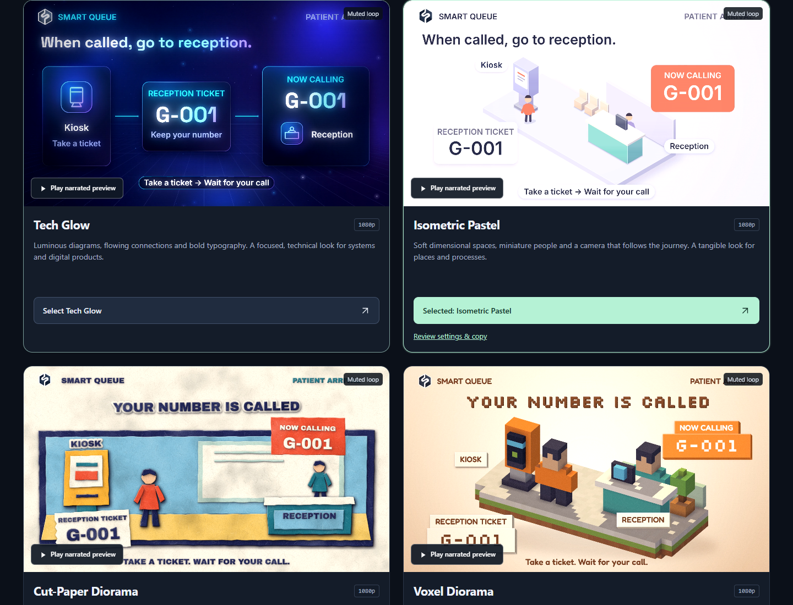
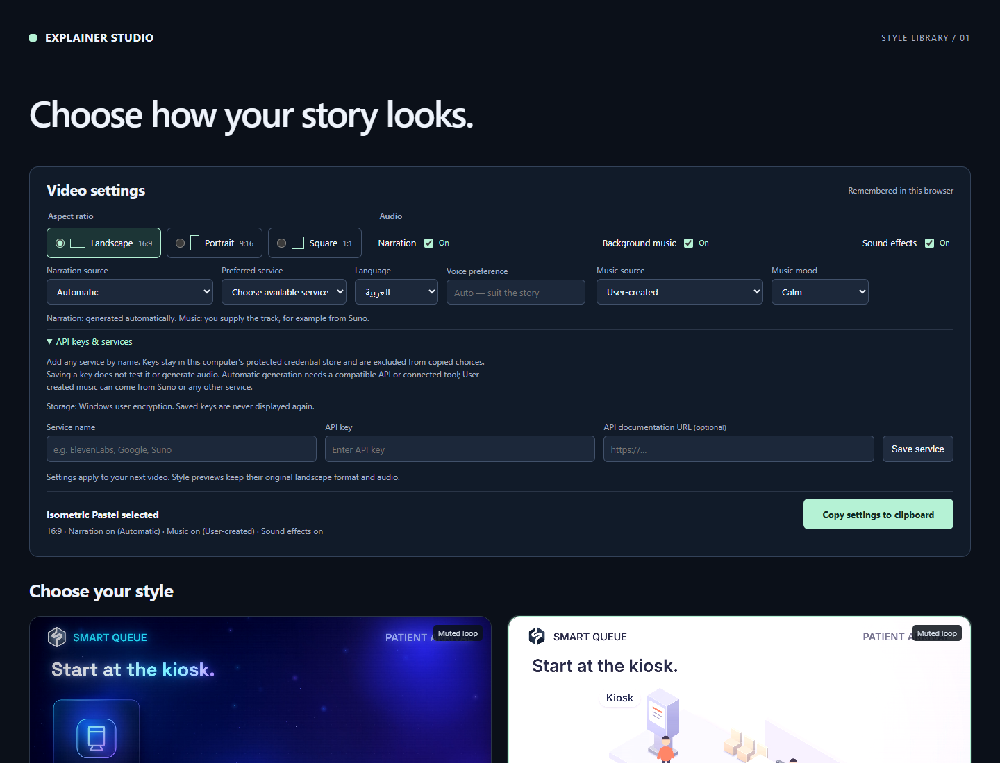

# Explainer Studio

Create animated explainer videos with a visual storyboard, optional narration, music and sound effects, and a choice of **18 distinct visual styles**. The style selector runs locally and is bundled with the Codex plugin.



## Install with your agent

Copy this prompt into Codex or an agent that can install Codex plugins on your computer:

```text
Install Explainer Studio from https://github.com/mostafalamey/explainer-studio.
Read the repository README and installation guide. Clone it with Git LFS and
fetch the bundled preview media. Register the cloned repository as a Codex
marketplace and install explainer-studio@explainer-studio. Set up the local
requirements needed to open the selector, launch it, and show me its local URL.
For video production, also set up the documented renderer dependencies and
PW_MODULE_PATH. Verify the installed plugin and the preview media, and report
anything that could not be completed. Direct me to the local API settings if
credentials are needed; do not ask me to paste API keys into chat. Wait for my
video brief and storyboard approval before generating paid audio or a video.
```

The plugin targets **Codex**. Another agent can help with setup, but a host without Codex/plugin support cannot install it as a native plugin.

## Manual installation

Install [Git](https://git-scm.com/downloads), [Git LFS](https://git-lfs.com/), [Python](https://www.python.org/downloads/) 3.10+ and a current Codex version with the `codex plugin` commands available in your terminal.

```sh
git lfs install
git clone https://github.com/mostafalamey/explainer-studio.git
cd explainer-studio
git lfs pull
codex plugin marketplace add .
codex plugin add explainer-studio@explainer-studio
python tests/smoke.py
```

On macOS/Linux, use `python3` if `python` is unavailable. The preview media is roughly 350 MB, so the first clone can take a little time. Use a Git LFS clone rather than relying on GitHub's Download ZIP, which may contain media pointers.

Start a new Codex chat if the skill is not visible, then paste:

> Use $create-explainer to explain my topic. Open the local style selector and show me a visual storyboard before building the animation.

**[Detailed installation, rendering setup, updates and troubleshooting](docs/INSTALL.md)**

## Open the style selector

Ask Codex to open the Explainer Studio style selector, or run this from the repository root:

```sh
python plugins/explainer-studio/skills/create-explainer/scripts/launch_selector.py
```

The launcher starts or reuses a loopback-only server and prints its URL, normally `http://127.0.0.1:8869/style-selector.html`. It opens your browser; add `--no-browser` when Codex will open the printed URL itself. A different free port is used if necessary. No public hosting is required.

- Click anywhere on a card to select its style.
- Small previews autoplay silently and loop. **Play narrated preview** selects the style and opens a large player with sound and a visible Close button.
- Choose landscape **16:9**, portrait **9:16**, or square **1:1**.
- Set narration, background music and sound effects independently.
- Click **Copy settings to clipboard**, then paste the choices into your Codex chat. Choices are remembered in that browser; they are not sent automatically.

## Audio and language settings



Narration and music each offer **Automatic** or **User-created**. Automatic uses a compatible connected tool or a preferred locally configured service. User-created prepares a script or music prompt and waits for the audio you supply. Music can come from **Suno**, Google AI Studio, a recording or another service.

Languages: **English · العربية · Français · Deutsch · Русский · 日本語 · 中文**. Language/voice preferences do not guarantee a particular provider model or voice is available.

Expand **API keys & services** to enter any **service name**, **API key**, and optional **API documentation URL**. Each person configures their own services. Saving a key does not test it, generate audio, authorize charges, or implement an API adapter. Custom automatic routes still need a compatible, verified API or connected tool.

Keys stay outside the repository and plugin in a protected per-user store. Windows uses DPAPI encryption. macOS/Linux require Python `keyring` with a secure Keychain/Secret Service backend; no plaintext fallback is used. Keys are excluded from browser storage, copied choices and generated video projects. Never paste a key into a chat, issue or screenshot.

## Available styles

| | | |
|---|---|---|
| Tech Glow | Isometric Pastel | Cut-Paper Diorama |
| Voxel Diorama | Punk Zine Collage | Glassmorphism UI |
| Tarot Card | Gouache Travel Poster | ISOTYPE Pictograms |
| Soft 3D Clay | Flat-Vector Science | Editorial Essay Collage |
| Claymation Set | Neon Sign at Night | Chalkboard Lesson |
| Memphis Group | Bauhaus Poster | Vintage Newsprint |

The bundled samples show the same Smart Queue patient-arrival moment in 1920 × 1080, 30 fps, with an 8.3-second English narrated preview. They demonstrate the styles; they are not a template that forces every project to use Smart Queue branding or claims. Selecting portrait, square or a different language applies to the next production; it does not regenerate the reference clips.

[Large narrated player screenshot](docs/screenshots/narrated-player.png)

## Production workflow

1. Define the topic, audience, facts, branding, duration and language.
2. Select a visual style and audio settings.
3. Review the visual storyboard and narration script.
4. Generate approved audio or supply your own files.
5. Animate, synchronize, review and export the MP4 with editable sources.

Video export additionally needs Node.js, FFmpeg/ffprobe, Playwright and a compatible browser. See the [installation guide](docs/INSTALL.md#video-production-dependencies). The current validation platform is Windows; macOS/Linux credential setup and rendering have not been end-to-end verified here.

## Repository layout

```text
.agents/plugins/marketplace.json    Codex marketplace entry
plugins/explainer-studio/           Installable plugin and all 18 style packs
  skills/create-explainer/          Skill, local selector, examples and tools
docs/INSTALL.md                    Installation and troubleshooting
docs/screenshots/                  Screenshots of the real local selector
tests/                            Portable package checks and credential tests
```

[Verification details](docs/verification.md) · [Changelog](CHANGELOG.md) · [Source and third-party notices](THIRD_PARTY_NOTICES.md)

No broad license is inferred for the user-supplied reference material. Original source provenance and bundled font notices are retained; see the notices before redistributing components under a different license.
